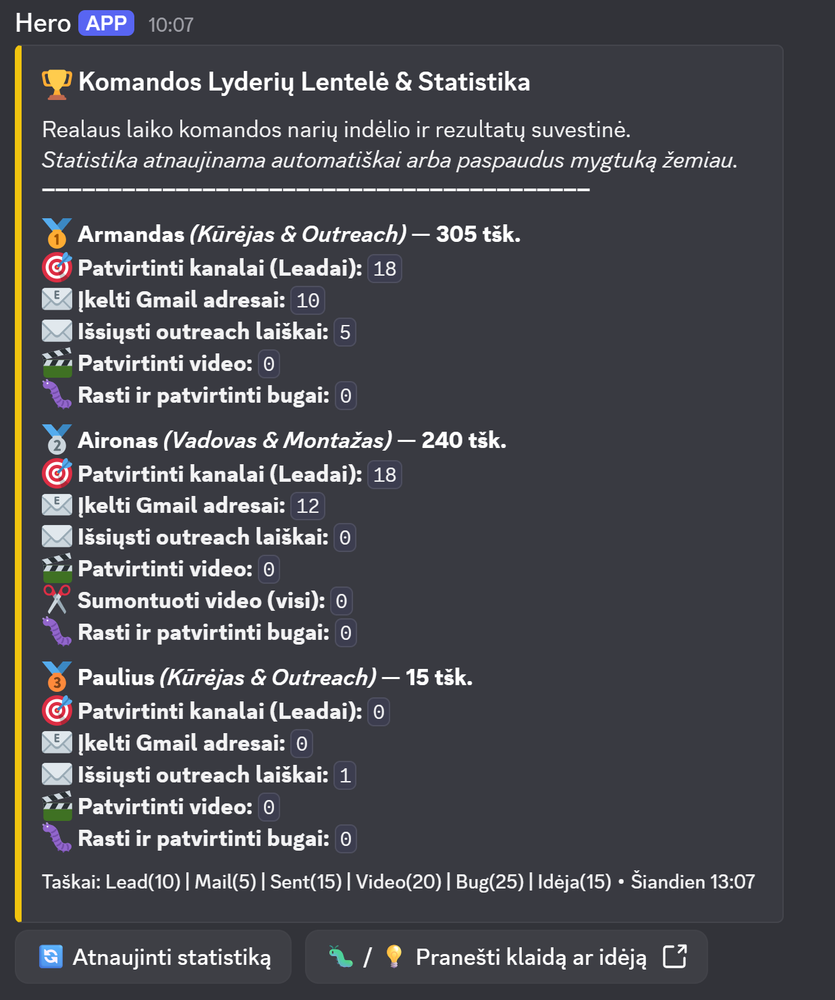
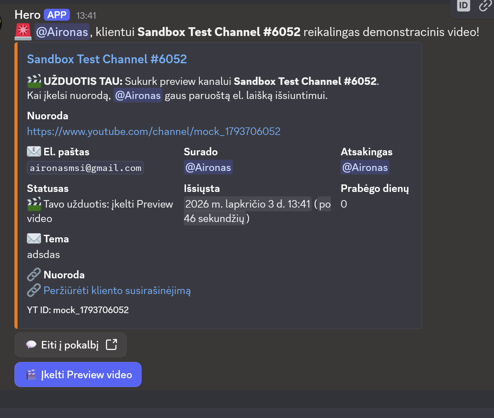
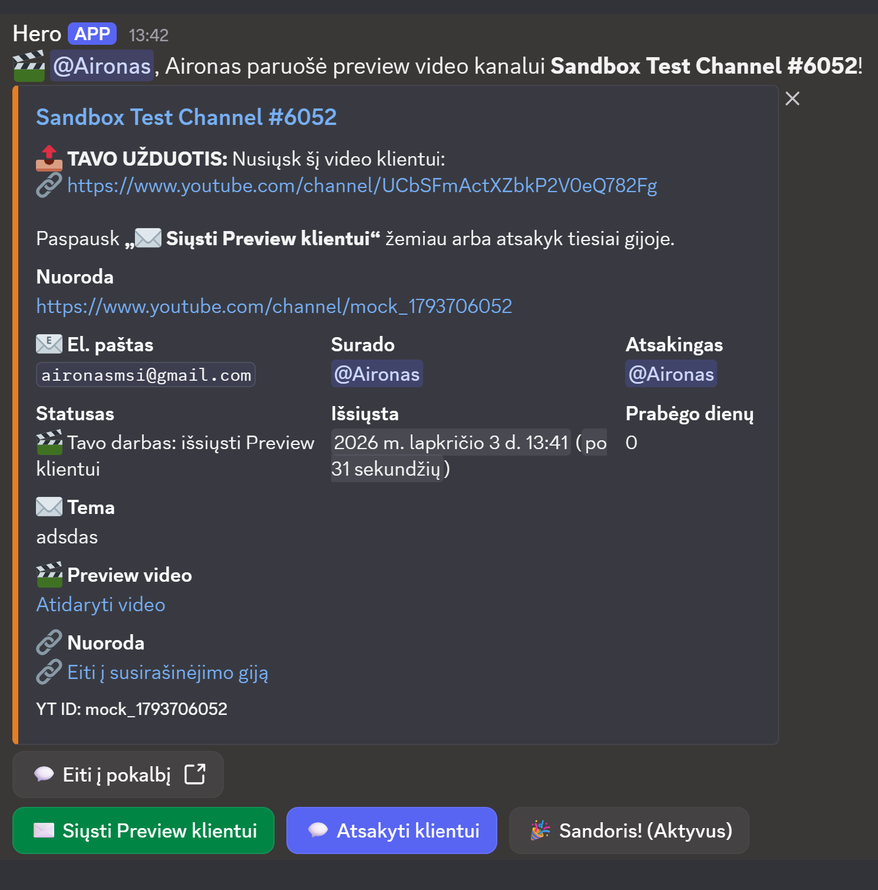
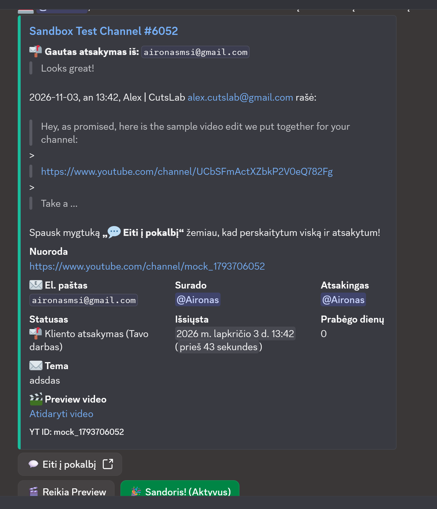
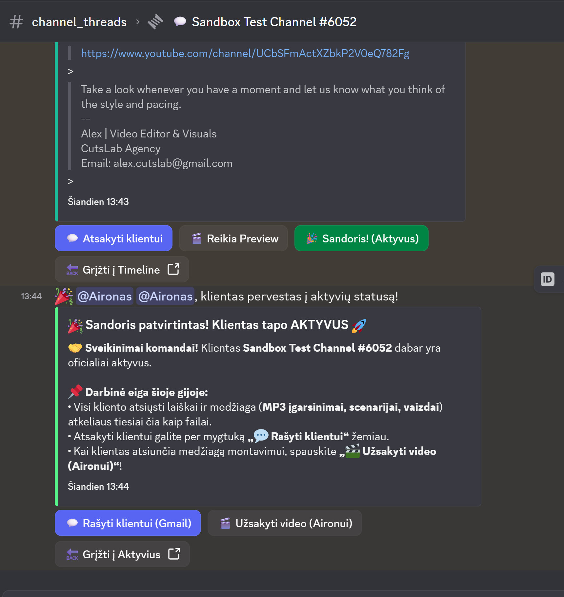
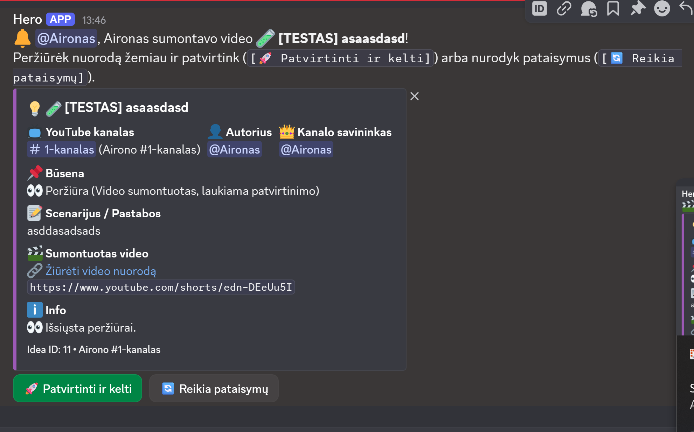
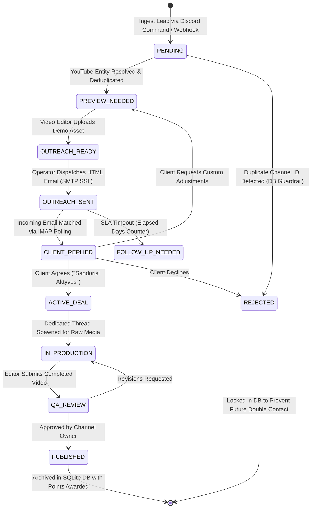

# Cloud CRM & Operations Agent — 24/7 Autonomous Team Workflow Engine

> **Enterprise Domain:** Distributed Operations CRM, Bi-Directional Email Synchronization & Autonomous Lead Pipeline  
> **Infrastructure:** Oracle Cloud VPS (Linux Ubuntu Server), systemd Daemon Management, Automated SSH Deployment  
> **Backend & Stack:** Python 3.10+, Discord API (`discord.py`), Asynchronous SQLite (`aiosqlite` WAL mode), `yt-dlp`  
> **Integration Layer:** Bi-Directional Gmail Integration (IMAP polling / SMTP SSL), Canonical Entity Resolution  
> **Design Pattern:** Asynchronous Finite State Machine (FSM), Event-Driven Architecture, Persistent Reboot-Proof UI  

---

## 🎯 What is Cloud CRM Agent? (Core Purpose & Mission)

**Cloud CRM Agent** (internally known as *Hero Operations Engine*) is a production-grade, autonomous CRM and agency workflow orchestrator hosted 24/7 on an **Oracle Cloud Infrastructure (OCI) Linux VPS**.

Designed for high-velocity creative production and outreach operations, the system replaces bloated commercial CRMs (such as HubSpot or Salesforce) by embedding a **fully relational, asynchronous state machine directly into a team's real-time Discord workspace**:

```text
[ Lead Discovery & Canonical Resolution ] ──▶ [ Preview Task Routing & Operator Assignment ]
                                                                     │
[ Active Project Thread & Asset Intake ] ◀── [ Bi-Directional Gmail Bridge (IMAP/SMTP) ] ◀── [ Client Outreach ]
```

---

## ⚡ Key Capabilities at a Glance

### 1. 📬 Bi-Directional Gmail Synchronization (IMAP / SMTP)
- **Direct Discord Outreach:** Operators draft and transmit professional, styled HTML emails directly through Discord interactive modals without switching tabs.
- **Asynchronous IMAP Thread Polling:** Background worker continuously monitors incoming mailboxes via IMAP SSL, matches `In-Reply-To` and `Message-ID` headers to active database records, and immediately posts client responses into dedicated Discord thread channels.
- **Conversation State Continuity:** Preserves complete correspondence threads in Discord, allowing the team to reply with a single click.

### 2. 🔀 Asynchronous Finite State Machine (FSM Pipeline)
- **Multi-Stage Operational Pipeline:** Manages client lifecycles across explicit, non-blocking states:
  $$\text{PENDING} \longrightarrow \text{PREVIEW\_NEEDED} \longrightarrow \text{OUTREACH\_SENT} \longrightarrow \text{REPLIED} \longrightarrow \text{ACTIVE} \ / \ \text{REJECTED}$$
- **Automated Task Routing:** When a lead enters the pipeline, the bot automatically generates dedicated action cards, mentions assigned team operators, sets deadlines, and tracks elapsed time.
- **Contract Conversion:** With one click (`Sandoris! (Aktyvus)`), the lead transitions to an active client, automatically spinning up dedicated workspace threads for asset intake (MP3 audio, scripts, footage).

### 3. 🔍 Canonical Entity Resolution & Deduplication (`yt-dlp`)
- **Automated Metadata Extraction:** Powered by `yt-dlp` to normalize arbitrary user-submitted URLs into canonical YouTube channel IDs.
- **Zero-Collision Guardrail:** Automatically checks incoming submissions against persistent SQLite archives, instantly rejecting duplicates before pinging operators, preserving team focus and preventing embarrassing double outreach.

### 4. 🏆 Team KPI Leaderboard & Real-Time Gamification
- **Point-Based Performance Index:** Automatically tracks team members' operational output across verified actions:
  - Validated Leads (+10 pts)
  - Verified Email Discovery (+5 pts)
  - Dispatched Outreach (+15 pts)
  - Video Production Edits (+20 pts)
  - Bug Reports / Verified QA (+25 pts)
- **Live Leaderboard Card:** Displays real-time rankings and metrics directly in the announcements channel, updated via atomic database queries.

### 5. 🛡️ Reboot-Resilient Persistent UI Components
- **Zero Lost State on Crashes/Restarts:** All Discord interactive elements (`Button`, `Select`, `Modal`) use explicit, deterministic `custom_id` strings and persistent view listeners (`timeout=None`).
- If the server restarts or the VPS reboots, buttons on messages sent days or weeks ago continue working immediately without throwing expired interaction errors.

### 6. 🐧 Enterprise Linux Daemonization (`systemd` on Oracle Cloud)
- **24/7 Continuous Operation:** Deployed as an autonomous Linux service on an **Oracle Cloud Infrastructure (OCI) Ubuntu VPS** with automatic crash restart policies (`Restart=always`).
- **Streamlined SSH Remote Management:** Custom bash and Windows batch automation scripts (`atnaujinti_bota.bat`, `isvalyti_duomenu_baze.bat`) enable one-command code synchronization via `scp` and daemon reload via `systemctl restart bot`.

---

## 🖥️ Production Interface Showcase

### 1. Real-Time Team KPI Leaderboard & Gamification

*Live operator performance ranking tracking validated leads, email discoveries, dispatched outreach, and video production points.*

### 2. Lead Ingestion & Production Task Assignment

*Automated operational card assigning dedicated video preview creation, linking canonical channel metadata, and tracking operator SLA.*

### 3. Client Outreach & Video Preview Delivery

*Dispatch stage card with direct email sending triggers, preview playback links, and dynamic elapsed-time counters.*

### 4. Bi-Directional Gmail Synchronization & Live Client Response

*Live client email response captured via IMAP and rendered directly into Discord embed with one-click reply actions.*

### 5. Contract Conversion & Active Lifecycle Thread

*Transitioning won deals into active client status, initializing workspace threads for incoming production assets (audio, scripts).*

### 6. Video Production Review & QA Approval Gate

*Creative pipeline QA gate allowing channel leads to review edited videos, trigger revisions, or approve for final publishing.*

---

## 🏗️ State Machine Architecture & Dataflow



---

## ⚙️ Technical Deep Dives Under the Hood

### 1. Asynchronous SQLite Storage Engine (`db.py`)
- Employs `aiosqlite` with WAL (`Write-Ahead Logging`) mode enabled:
  ```sql
  PRAGMA journal_mode=WAL;
  PRAGMA synchronous=NORMAL;
  ```
- Guarantees non-blocking database queries even during rapid concurrent button presses and background IMAP email polling cycles.
- Schema migration engine automatically ensures backwards-compatible column additions across production updates without data loss.

### 2. Bi-Directional Mailer Engine (`mailer.py`)
- **Outbound Dispatch:** Formats dynamic multi-part MIME messages (`text/plain` + responsive HTML styled with inline CSS signatures) sent over `smtplib.SMTP_SSL`.
- **Inbound Tracking:** Connects to Gmail over `imaplib.IMAP4_SSL`, fetching unread message envelopes, parsing MIME multipart payloads, resolving character sets, and mapping inbound `Message-ID` trees back to target SQLite records.

### 3. Canonical YouTube Entity Extractor (`youtube.py`)
- Utilizes headless `yt-dlp` process execution to resolve vanity handles (`@username`), custom URLs (`/c/name`), and video IDs into single, immutable channel ID keys (`UC...`).
- Eliminates duplicate entries caused by varying URL formats.

---

## 🛠️ Technology Stack Breakdown

| Layer | Technologies | Purpose |
|---|---|---|
| **Cloud Infrastructure** | Oracle Cloud VPS (Ubuntu Linux), systemd | 24/7 daemon hosting, automated watchdog recovery |
| **Runtime & Framework** | Python 3.10+, `discord.py` v2.x, AsyncIO | Event loop, persistent UI views, bot lifecycle router |
| **Database & Persistence** | SQLite3, `aiosqlite` (WAL Mode) | Relational state machine storage, atomic transactions |
| **Email Integration** | `smtplib.SMTP_SSL`, `imaplib.IMAP4_SSL`, MIME | Bi-directional outreach and response monitoring |
| **Media & Extraction** | `yt-dlp` | Canonical entity extraction, video metadata retrieval |
| **Deployment Automation** | SSH, SCP, Bash, Windows Batch Scripts | One-click remote deployment and database backup sync |

---

## 📁 Repository Structure

```text
Cloud-CRM-Agent/
├── bot.py                  # Main Discord application, persistent views, event routers & modals
├── db.py                   # Asynchronous aiosqlite database schema, migrations & CRUD operations
├── config.py               # Environment variables, role IDs, channel mappings & permissions
├── mailer.py               # Bi-directional Gmail client (SMTP sending + IMAP polling daemon)
├── youtube.py              # yt-dlp canonical channel resolution & metadata extraction
├── requirements.txt        # Python dependency manifest
├── assets/                 # High-resolution production UI screenshots
└── deploy/
    ├── bot.service         # systemd daemon configuration unit
    ├── atnaujinti_bota.bat # Automated SSH code deployment script
    └── backup_db.bat       # Remote database backup sync script
```

---

## 🔒 Enterprise & Proprietary Notice
*The architectural models, pipeline designs, and operational workflows shown here represent proprietary commercial systems developed by Aironas Žitkus. Sensitive API tokens, SSH keypairs, and private client databases are strictly excluded from public version control.*
